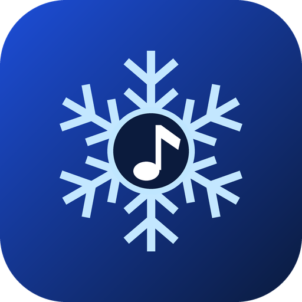

# ❄️ Noten-Editor

Browser-Editor für kleine Ensemble-Stücke, ursprünglich für *O Snowflakes how Gently / Schneeflöckchen* (Violine I/II, Viola, Cello). Eine einzige HTML-Datei, keine Installation, kein Server. Läuft auch offline (Service Worker) und lässt sich auf dem Handy als App installieren.

## Neu in v7: Wiederholungen, Akkorde, Text
- **Wiederholungszeichen an jedem Takt** (Tab „Takt“ → Wiederholung: 𝄆 Beginn / Ende 𝄇). Beim Abspielen wird der Teil dazwischen zweimal gespielt, auch bei „ab Auswahl“ und mit Metronom.
- **Akkordsymbole und Textmarken** (Tab „Note“ → Akkord & Text, z. B. `D`, `A7`, `Hm`, „Vers:“, „Refräng:“). Sie stehen über dem System.
- **Tempoangabe** ♩ = … steht über dem ersten System.
- **Import:** liest jetzt auch Wiederholungszeichen, Akkorde (`harmony`) und Text (`words`) aus MusicXML, dazu komprimierte **.mxl**-Dateien. **Export** schreibt alles wieder zurück.
- Beispiel „Hujedamej sånt barn han var“ (Datei → Beispiel: Hujedamej) zeigt alles zusammen: D-Dur, 2/4, Wiederholungen, Pausen, Akkorde.

## Funktionen
- **Bearbeiten:** Tonhöhe (Stufe, ♯/♭/♮, Oktave), Notenwert (32stel bis Ganze, punktiert), Pausen aller Werte, Bögen, Noten einfügen/löschen, Liedtext (2 Strophen)
- **Eingabemodus:** Notenwert wählen, Ton tippen (C–H, auch per Tastatur), Cursor springt weiter, Takt wird automatisch aufgefüllt und am Ende automatisch angehängt
- **Control-Panel** mit Tabs (Note, Takt, Stimme, Wiedergabe, Ansicht, Datei): Taktart, Tonart, Tempo, Schlüssel, Name, Instrument, Lautstärke, Stimmen hinzufügen/entfernen, Metronom, Zoom
- **Hell/Dunkel/Automatisch**
- **Rückgängig/Wiederholen** (Strg+Z / Strg+Y)
- **Takte** am Ende anhängen (beliebig viele), einfügen, duplizieren, löschen, Stimme um Oktave oder Halbton transponieren
- **Import** und **Export** von MusicXML (alle Stimmen, Einzelstimme oder Klavier-Auszug)
- **Instrument pro Stimme** (Violine, Bratsche, Cello, Klavier, Flöte, Oboe, Blockflöte, Fagott, Gitarre, Harfe, Orgel), wird als MIDI-Programm exportiert
- **Abspielen** mit Web Audio (Tempo, Stimmen an/aus, ab gewählter Note, Hall); Antippen einer Note spielt sie an
- **Spuren ein-/ausblenden:** Nur die gewählten Stimmen werden angezeigt und gespielt; ein Cursor folgt der Auswahl bzw. der Wiedergabe, die Ansicht scrollt mit
- Zeilenumbruch nach wählbarer Taktzahl, automatische Taktprüfung, Autosave im Browser

## Online stellen (GitHub Pages)
*Settings → Pages → Branch `main`, Ordner `/ (root)`*. Danach ist die App unter `https://<name>.github.io/<repo>/` erreichbar.

## Grenzen
- Import: je System nur die erste Stimme, keine Triolen, keine Volta-Klammern (1./2. Schluss), keine Dacapo/Segno
- Klang ist ein einfacher Synthesizer, keine echten Instrumentenaufnahmen

## Lizenz
MIT
